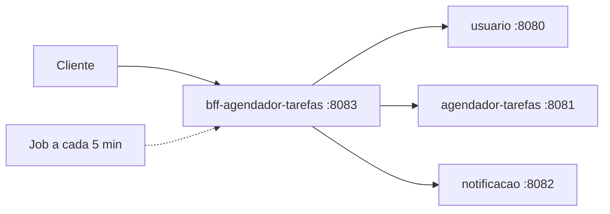

# bff-agendador-tarefas

**Backend for Frontend** do Agendador de Tarefas. É a porta de entrada única do cliente: expõe as rotas de usuário e de tarefas, repassa as chamadas aos microsserviços via OpenFeign e documenta tudo com Swagger.

Também roda um **job agendado** (a cada 5 minutos) que busca as tarefas marcadas para a próxima hora, envia o lembrete por e-mail pelo serviço `notificacao` e atualiza o status da tarefa.

**Stack:** Java 17 · Spring Boot 4 · OpenFeign · Springdoc OpenAPI (Swagger) · `@Scheduled`

## Arquitetura



Repositórios do ecossistema: [usuario](https://github.com/GabrielBarrilli/usuario) · [agendador-tarefas](https://github.com/GabrielBarrilli/agendador-tarefas) · [notificacao](https://github.com/GabrielBarrilli/notificacao)

## Rotas

| Grupo | Base | Operações |
| --- | --- | --- |
| Usuário | `/v1/usuario` | login, cadastro, atualização, busca, endereços e telefones |
| Tarefas | `/tarefas` | criar, listar por usuário ou período, atualizar, alterar status, excluir |

Com a aplicação rodando, a documentação interativa fica em `http://localhost:8083/swagger-ui/index.html`.

## Como rodar

```bash
export USUARIO_URL=localhost:8080
export AGENDADOR_TAREFAS_URL=localhost:8081
export NOTIFICACAO_URL=localhost:8082
export USUARIO_EMAIL=<e-mail da conta usada pelo job>
export USUARIO_SENHA=<senha da conta usada pelo job>
./gradlew bootRun   # sobe na porta 8083
```
